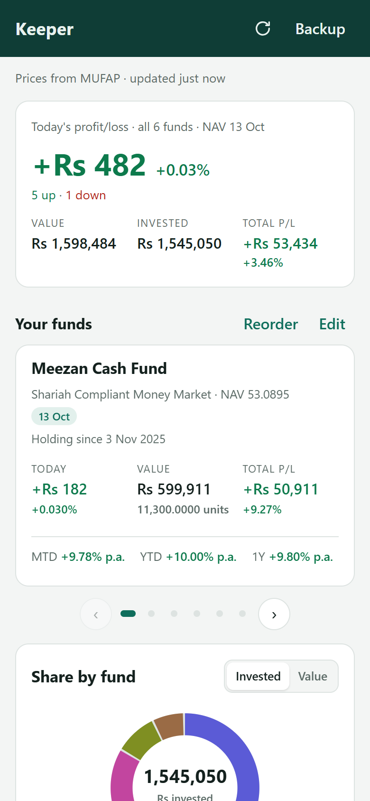
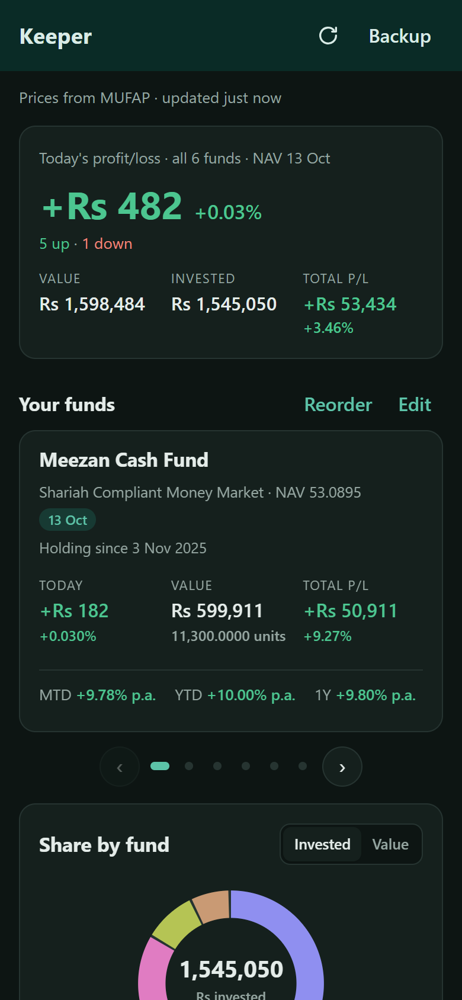
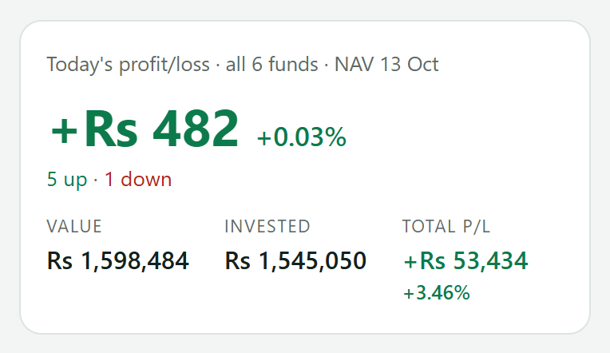
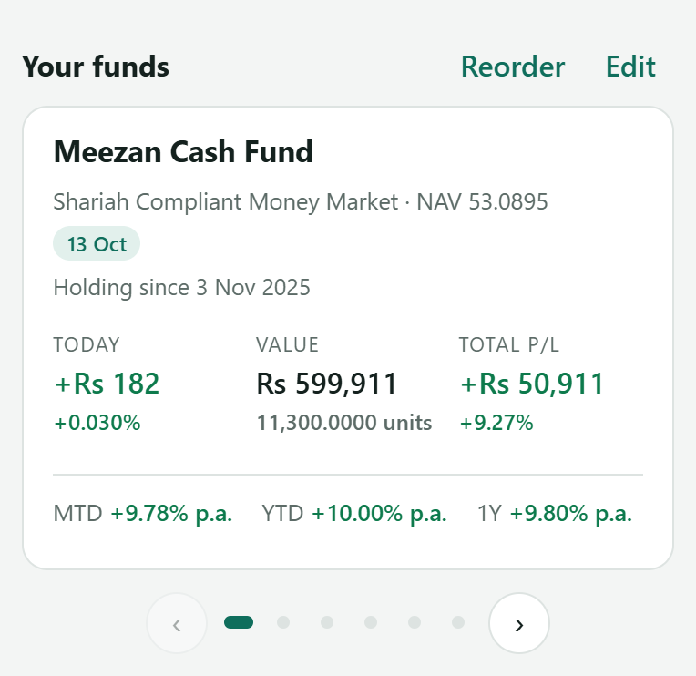
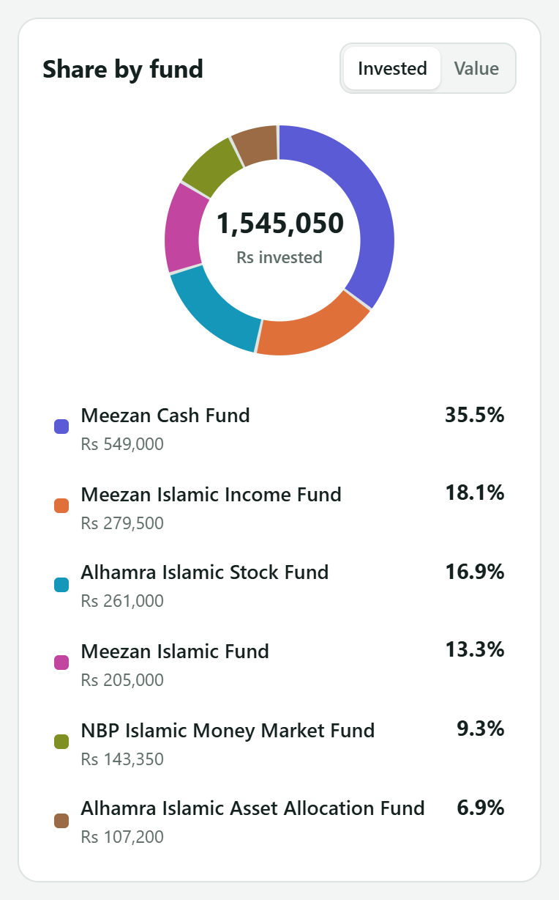
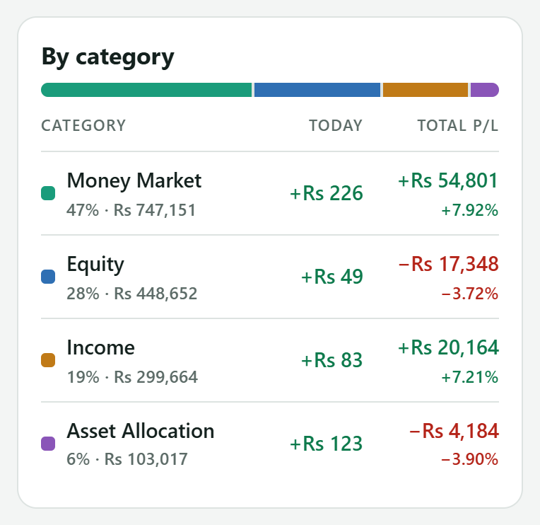
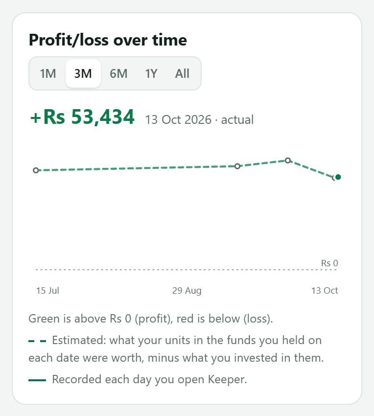

# Keeper

**All my mutual funds in one place.** Keeper is a small phone app that shows the daily and total profit/loss of Pakistani mutual funds, so I don't have to log in to a separate app for every fund company.

It reads the public daily prices from [MUFAP](https://www.mufap.com.pk/Industry/IndustryStatDaily?tab=1) (Mutual Funds Association of Pakistan). Your holdings stay on your phone.

**Live demo with sample data:** <https://usmanasifbutt.github.io/fund-keeper/#demo>

<p align="center">
  
  &nbsp;&nbsp;
  
</p>

> Keeper is a personal tracking tool, **not investment advice**. See [Terms](docs/TERMS.md).

## What it shows

| | |
|---|---|
|  | **Today, across all funds.** Today's profit/loss, how many funds went up or down, total value, amount invested and total profit/loss. |
|  | **One card per fund.** Swipe sideways. Each card shows today's change, value, units, total profit/loss and the fund's month, year-to-date and 1-year returns. Cards can be reordered. |
|  | **Share by fund.** How your money is split, by amount invested or by current value. |
|  | **By category.** Equity, Money Market, Income and Asset Allocation, each with today's and total profit/loss. |
|  | **Profit/loss over time.** 1 month to 1 year. Green above Rs 0, red below. Loads only when you scroll to it. |

## What it tracks and stores

For each fund you enter:

- **Fund**, picked from MUFAP's list of about 550 funds
- **Units** you hold
- **Amount invested** in rupees
- **First invested date** (optional)

That's all. It's saved in your phone's browser storage and **never leaves your phone**. There are no accounts, no server and no analytics. Each day's portfolio total is also saved on the phone to draw the chart. Details: [Privacy](docs/PRIVACY.md).

Prices come from MUFAP's public Performance Summary, fetched when you open the app (at most every 30 minutes).

## Use it

1. Open <https://usmanasifbutt.github.io/fund-keeper/> on your phone.
2. **Add to Home screen.** Android Chrome: menu ⋮ → *Install app*. iPhone Safari: Share → *Add to Home Screen*.
3. Tap **Add your funds**, search for each fund and enter your units and the amount invested.

Full guide, including buying more, dividends and backups: **[docs/USAGE.md](docs/USAGE.md)**.

<p align="center">
  
  &nbsp;&nbsp;
  
</p>

## Run it yourself

Needs [Node.js](https://nodejs.org) 20 or newer.

```bash
git clone https://github.com/usmanasifbutt/fund-keeper.git
cd fund-keeper
npm install
npm run dev
```

Open the address it prints. Add `#demo` to the end of the address to see sample data.

| Command | What it does |
|---|---|
| `npm test` | Runs the tests |
| `npm run build` | Builds the app into `dist/` |
| `npm run preview` | Serves the built app |
| `npm run screenshots` | Re-captures the images in `docs/images` from the demo (needs `npm run preview` running and Chrome installed) |

**Host your own copy (free):** fork this repo, then go to *Settings → Pages* and set *Source* to **GitHub Actions**. Every push to `main` or `master` publishes the app to `https://<your-username>.github.io/fund-keeper/`.

## Docs

- [How to use Keeper](docs/USAGE.md)
- [How the numbers are worked out](docs/HOW-IT-WORKS.md)
- [Privacy](docs/PRIVACY.md)
- [Terms and disclaimer](docs/TERMS.md)

## Disclaimer

Keeper is a personal project, built so I can see all my funds in one place without opening several fund company apps. It does **not** give investment, financial or tax advice, and it is not affiliated with MUFAP, MCB Funds, Al Meezan or any other fund manager. Prices can be late or wrong. Always check your official statements before making decisions. See [Terms](docs/TERMS.md).
