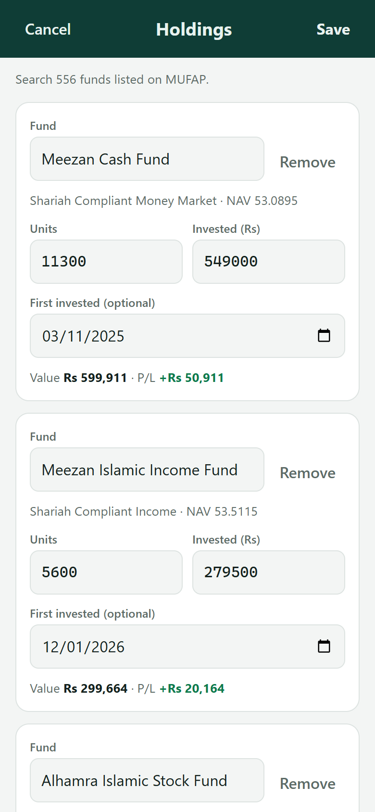
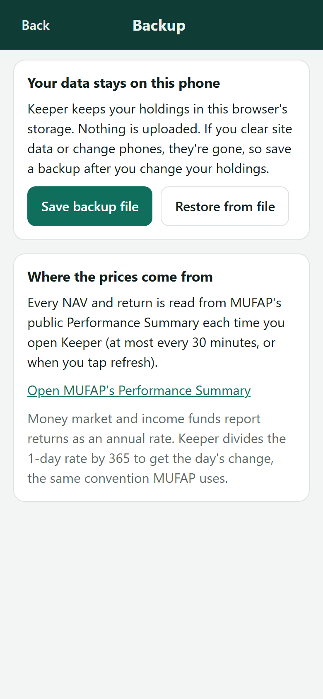

# How to use Keeper

## Install it on your phone

1. Open <https://usmanasifbutt.github.io/fund-keeper/> in your phone's browser.
2. Add it to your home screen:
   - **Android (Chrome):** menu ⋮ → **Install app** (or **Add to Home screen**).
   - **iPhone (Safari):** Share button → **Add to Home Screen**.
3. Open Keeper from its icon. It opens full screen like any other app.

Want to look around first? Open <https://usmanasifbutt.github.io/fund-keeper/#demo>. It shows sample holdings, and nothing you change there is saved.

## Add your funds

1. Tap **Add your funds** (or **Edit** on the home screen).
2. In **Fund**, type part of the name, for example `meezan cash` or `alhamra stock`, and pick it from the list.
3. Enter:
   - **Units**: from your purchase confirmation SMS/email or account statement.
   - **Invested (Rs)**: the total you've paid into that fund, including any front-end load.
   - **First invested** (optional): the date of your first purchase. The chart then starts from that date.
4. Tap **+ Add fund** for the next one.
5. Tap **Save**.

If a row is half filled, for example you typed a name but didn't pick from the list, Keeper highlights it and doesn't save.

 

## Keep it up to date

| What happened | What to change |
|---|---|
| Bought more units | Edit → **+ Add more units** on that fund → enter the amount paid and the units received. Keeper adds them to the totals, and can estimate the units from the latest NAV |
| Bought a new fund | **+ Add fund** |
| Dividend paid as extra units | **+ Add more units** with the amount left at 0, so **Invested** stays the same because it isn't new money |
| Sold some units | Reduce **Units**, and reduce **Invested** in proportion |
| Sold everything in a fund | **Remove** |

Prices update by themselves each time you open the app (at most every 30 minutes). Tap ⟳ to refresh now.

## Read the home screen

- **Today's profit/loss:** the change on each fund's latest NAV day, added up across your funds. Funds publish NAVs at slightly different times, so each card shows its own NAV date. A fund with **no new NAV for 2 or more working days** is left out of today's total and its card says **No update**; its value still counts in your totals.
- **Your funds:** swipe the cards, or use ‹ › and the dots. Tap **Reorder** to change the order.
- **Share by fund:** shows each fund's share of your portfolio's current **Value**. Switch to **Invested** to see how the money you put in is split. Tap a slice to see its percentage.
- **By category:** profit/loss for Equity, Money Market, Income and Asset Allocation.
- **Profit/loss over time:** pick 1M–1Y. Each point is your **total** profit/loss on that date, not that day's gain. Tap a point to see its total and the change on that day. The dashed part is estimated from MUFAP's past returns. The solid part is recorded each day you open the app. Details: [How it works](HOW-IT-WORKS.md#profitloss-over-time).

Money market and income funds report returns as an annual rate, marked **p.a.** on the cards.

## Back up your holdings

Your holdings live only in this phone's browser. Clearing site data, uninstalling the browser or changing phones removes them.

- **Save backup file:** downloads a small `.json` file. Keep it in Google Drive or email it to yourself.
- **Restore from file:** loads a backup, for example on a new phone.

Save a backup whenever you change your holdings.

 

## Troubleshooting

| Problem | Fix |
|---|---|
| "Couldn't reach MUFAP" | Check your internet and tap ⟳. The last saved prices stay on screen. |
| A fund says it isn't in MUFAP's list | The fund was closed or renamed. Remove it and add the new name. |
| Today's change is Rs 0 for a fund | MUFAP hasn't published that fund's new NAV yet. Check again in the evening. |
| Numbers differ slightly from the fund company's app | Keeper uses MUFAP's NAV. Your statement may use a different price date or deduct loads and taxes. |
